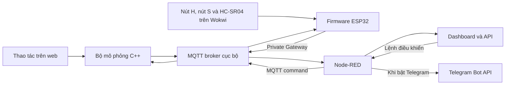

# Smart Bin v4 – Mô phỏng thùng rác thông minh

Đồ án IoT của Nhóm 06 mô phỏng thùng rác mở nắp khi phát hiện tay, đo mức rác ở hai vùng bằng HC-SR04 và hỗ trợ quy trình thay túi. Node-RED hiển thị trạng thái, chuyển lệnh qua MQTT và gửi thông báo Telegram ở các mốc 80%, 90% và 100%.

Dự án có hai nguồn dữ liệu mô phỏng. Demo web tạo tín hiệu tay và khoảng cách để chạy kịch bản tự động. Wokwi chạy firmware ESP32 và cho phép thao tác trực tiếp trên sơ đồ mạch. Cả hai dùng chung bộ điều khiển C++ trong `include/`.

## Kiến trúc và luồng dữ liệu



Mỗi phiên demo chọn một nguồn telemetry. Để dùng **Wokwi và web cùng lúc**, chạy chế độ `--wokwi`. Người dùng chỉnh hai HC-SR04 và thao tác nút H/S trên Wokwi, còn trang web hiển thị dữ liệu và thông báo của chính ESP32 mô phỏng. Dashboard Node-RED vẫn có thể gửi lệnh điều khiển qua MQTT.

1. **Nhận tay và mở nắp.** Nút H mô phỏng đầu ra của cảm biến hồng ngoại. Khi giữ H, GPIO 13 xuống mức `LOW` và bộ điều khiển ra lệnh cho servo mở. Sau khi nhả H, nắp giữ thêm 3 giây trong chế độ tự động.
2. **Đo hai vùng.** Khi nắp đóng và đã ổn định 2 giây, bộ điều khiển kích hai HC-SR04 lần lượt. Khoảng cách được lọc trung vị và quy đổi theo mốc gần rỗng 40 cm, đầy 4 cm. Giá trị tổng hợp hiển thị trên dashboard là trung bình của A và B khi cả hai phép đo hợp lệ.
3. **Xác nhận đầy và báo tại chỗ.** Sau khi đã xác minh thùng gần rỗng, bộ điều khiển cần ba cặp phép đo liên tiếp với cả hai vùng trên 90% để xác nhận đầy trong điều kiện hợp lệ. Khi trạng thái đầy được xác nhận, còi phát tối đa 3 tiếng, mỗi tiếng 200 ms và cách nhau 3 giây tính từ lúc bắt đầu. Đèn LED báo trạng thái tại chỗ.
4. **Gửi dữ liệu và Telegram.** Thiết bị mô phỏng phát telemetry schema 4 qua MQTT. Node-RED kiểm tra dữ liệu rồi công bố mốc 80% và 90% dựa trên giá trị thấp hơn của A và B. Mốc 100% cần thêm trạng thái `full` từ bộ điều khiển. Mỗi mốc gửi một tin nhắn văn bản trong một chu kỳ đổ đầy. Nếu số đo nhảy qua một mốc, Node-RED xử lý theo mốc cao hơn đang quan sát được.
5. **Điều khiển và xác nhận.** Dashboard gửi lệnh đến Node-RED. Node-RED gắn mã yêu cầu, mã phiên khởi động của thiết bị và thời hạn rồi phát lệnh MQTT. Thiết bị trả kết quả xử lý trong telemetry. Mục trạng thái nắp biểu thị lệnh đóng hoặc mở của servo vì mạch mô phỏng chưa có cảm biến phản hồi vị trí.

## Cấu trúc mã nguồn

| Tệp hoặc thư mục | Vai trò |
| --- | --- |
| [`src/main.cpp`](src/main.cpp) | Firmware ESP32. Khởi tạo GPIO, đo Echo, điều khiển servo, LED và còi, vận hành Wi-Fi/MQTT, phát telemetry và nhận lệnh. |
| [`src/assessment_checks.cpp`](src/assessment_checks.cpp), [`src/supervision_checks.cpp`](src/supervision_checks.cpp) | Kiểm tra tại thời điểm biên dịch cho quy tắc xác nhận đầy, xác minh thùng rỗng và phát hiện số đo bất thường. |
| [`include/config.h`](include/config.h) | Sơ đồ chân, khoảng cách hiệu chuẩn, chu kỳ lấy mẫu, cấu hình còi và thông số MQTT của firmware. |
| [`include/bin_logic.h`](include/bin_logic.h) | Logic đóng/mở nắp, lọc và quy đổi khoảng cách, đánh giá mức rác từ hai vùng đo. |
| [`include/supervision.h`](include/supervision.h) | Lọc dội nút, phát hiện tay che lâu, kiểm tra phép đo bất thường và xác minh sau khi thay túi. |
| [`include/controller.h`](include/controller.h) | Phối hợp các trạng thái nắp, phép đo, thay túi và còi. Firmware ESP32 và bộ mô phỏng web cùng gọi lớp này. |
| [`simulator/index.html`](simulator/index.html) | Giao diện web bằng HTML, CSS và JavaScript. Hiển thị sơ đồ, các điều khiển mô phỏng, trạng thái và thông báo. |
| [`simulator/native.cpp`](simulator/native.cpp) | Chạy bộ điều khiển C++ trên Windows. Nhận đầu vào mô phỏng qua `stdin` và trả trạng thái JSON qua `stdout`. |
| [`simulator/server.cjs`](simulator/server.cjs) | Máy chủ Node.js phục vụ web/API, khởi động MQTT broker Aedes và Node-RED, kết nối bộ mô phỏng C++ hoặc dữ liệu Wokwi với giao diện. |
| [`node-red/flows.json`](node-red/flows.json), [`node-red/settings.js`](node-red/settings.js) | Luồng MQTT, dashboard, API, Telegram và cấu hình Node-RED khi chạy riêng. Trình khởi động demo tạo cấu hình cục bộ từ luồng này. |
| [`node-red/functions/`](node-red/functions/), [`node-red/dashboard.html`](node-red/dashboard.html) | Mã của các Function node và giao diện dashboard. `ingest.js` kiểm tra telemetry và tạo cảnh báo. `command.js` xác thực và đóng gói lệnh. |
| [`node-red/package.json`](node-red/package.json), [`node-red/package-lock.json`](node-red/package-lock.json) | Danh sách thư viện Node.js và phiên bản đã khóa để cài bằng `npm ci`. |
| [`scripts/`](scripts/) | `start_project.cjs` khởi động một phiên demo, `build_native.ps1` biên dịch và kiểm tra bộ mô phỏng, `build_flows.cjs` cập nhật luồng Node-RED, `export_wokwi.cjs` xuất mã và sơ đồ cho Wokwi. |
| [`platformio.ini`](platformio.ini), [`diagram.json`](diagram.json), [`wokwi.toml`](wokwi.toml), [`wokwi-local/`](wokwi-local/) | Cấu hình biên dịch firmware, kết nối các linh kiện và chọn firmware theo chế độ Wokwi. |
| [`tests/`](tests/) | Kiểm thử C++, luồng Node-RED, MQTT, API, khởi động và dừng demo, cùng kịch bản thử nút H trên Wokwi CLI. |

### Linh kiện trên sơ đồ Wokwi

| Linh kiện | Chân ESP32 | Vai trò |
| --- | --- | --- |
| Nút H | GPIO 13 | Mô phỏng phát hiện tay ở mức thấp. |
| Nút S | GPIO 14 | Bắt đầu thay túi và yêu cầu kiểm tra túi sau khi thay. |
| HC-SR04 A | Trig GPIO 25, Echo GPIO 26 | Đo khoảng cách từ nắp tới vùng A. |
| HC-SR04 B | Trig GPIO 32, Echo GPIO 33 | Đo khoảng cách từ nắp tới vùng B. |
| Servo | GPIO 18 | Mô phỏng đóng/mở nắp. |
| Còi piezo và LED | GPIO 19 và GPIO 23 | Phát âm báo và hiển thị trạng thái. |

## Chạy demo web trên Windows

1. Cài [Node.js 24 kèm npm](https://nodejs.org/en/download) và [Zig 0.13.0](https://ziglang.org/download/#release-0.13.0). Thêm thư mục chứa `zig.exe` vào `Path` rồi mở lại PowerShell.
2. Mở PowerShell ở thư mục gốc dự án và chạy lần lượt. Lệnh thứ hai biên dịch bộ mô phỏng và chạy kiểm thử C++.

   ```powershell
   npm ci --prefix node-red --include=dev
   powershell -NoProfile -ExecutionPolicy Bypass -File .\scripts\build_native.ps1
   node scripts/start_project.cjs
   ```

3. Mở [trang mô phỏng](http://127.0.0.1:8765/) và chọn **Chạy demo báo đầy** để xem các mốc thông báo. Bạn cũng có thể thử nút phát hiện tay và điều chỉnh khoảng cách A/B.
4. Mở [dashboard](http://127.0.0.1:1882/bin) để xem dữ liệu và gửi lệnh, hoặc [Node-RED Editor](http://127.0.0.1:1882/) để quan sát luồng. Dừng phiên bằng nút **Dừng mô phỏng** hoặc `Ctrl+C` tại PowerShell đang chạy.

## Chạy Wokwi trong VS Code

Mở thư mục gốc của repo trong VS Code. Cài hai extension **PlatformIO IDE** và **Wokwi Simulator**. Chạy lệnh `pio` trong terminal PlatformIO nếu PowerShell chưa nhận lệnh này.

### Trình bày mạch độc lập

1. Chạy `pio run -e esp32dev` để tạo firmware.
2. Nhấn `F1`, chọn **Wokwi: Select Config File** và chọn `wokwi.toml` ở thư mục gốc. Sau đó chạy **Wokwi: Start Simulator**.
3. Giữ nút H để mở nắp. Chỉnh khoảng cách trên từng HC-SR04 khi cần thử mức rác. Dùng nút S để thử quy trình thay túi.

### Wokwi kết nối web và Node-RED

1. Chạy `npm ci --prefix node-red --include=dev` nếu chưa cài thư viện. Chạy `node scripts/start_project.cjs --wokwi` ở thư mục gốc để khởi động các dịch vụ cục bộ. Chế độ này dùng firmware Wokwi làm bộ điều khiển nên có thể bỏ qua bước biên dịch C++ bằng Zig.
2. Chạy `pio run -e esp32-wokwi-local` trong terminal PlatformIO.
3. Chọn `wokwi-local/wokwi.toml` bằng **Wokwi: Select Config File**, mở **Wokwi: Start Simulator** và bật **Private Gateway** để ESP32 gọi `host.wokwi.internal:18885`. [Tài liệu cấu hình Wokwi](https://docs.wokwi.com/vscode/project-config) · [Tài liệu mạng ESP32 trên Wokwi](https://docs.wokwi.com/guides/esp32-wifi)
4. Chờ `MQTT connected` trong Wokwi Terminal rồi mở trang web hoặc dashboard. Đặt hai cảm biến ở 40 cm trong vài chu kỳ để xác minh trạng thái gần rỗng trước khi tăng mức rác. Khi hạ khoảng cách, thử lần lượt 11 cm, 7 cm và 3 cm cho cả hai vùng, chờ hệ thống lấy đủ mẫu ở từng mốc.

Nếu Wokwi báo `firmware binary ... not found`, kiểm tra đã biên dịch đúng môi trường `esp32dev` hoặc `esp32-wokwi-local` tương ứng với tệp `wokwi.toml` đang chọn. Nếu mạch chạy nhưng dashboard báo ngoại tuyến, kiểm tra dòng `MQTT connected`, Private Gateway và phiên web đã chạy với `--wokwi`.

## Bật thông báo Telegram

Tạo bot bằng BotFather, mở cuộc trò chuyện với bot và gửi `/start`. Dừng phiên demo đang chạy trước khi bật Telegram. Trong PowerShell ở thư mục dự án, nhập token và Chat ID vào biến môi trường của phiên hiện tại.

```powershell
$botToken = Read-Host 'Bot Token' -AsSecureString
$env:TELEGRAM_BOT_TOKEN = [System.Net.NetworkCredential]::new('', $botToken).Password.Trim()
$env:TELEGRAM_CHAT_ID = (Read-Host 'Chat ID').Trim()
$env:TELEGRAM_ENABLED = 'true'
```

Nếu chưa biết Chat ID, gửi một tin nhắn mới cho bot, rồi chạy lệnh tra cứu trong cùng cửa sổ PowerShell sau khi đặt token. Chọn `Id` của cuộc trò chuyện muốn nhận cảnh báo và điền lại `TELEGRAM_CHAT_ID`, giữ dấu âm nếu ID có dấu âm. [Telegram Bot API](https://core.telegram.org/bots/api#getupdates)

```powershell
try {
    $updatesUrl = "https://api.telegram.org/bot$($env:TELEGRAM_BOT_TOKEN)/getUpdates"
    $updates = Invoke-RestMethod -Uri $updatesUrl -TimeoutSec 15 -ErrorAction Stop
    $updates.result | ForEach-Object { $_.message.chat } |
        Where-Object { $_ } | Select-Object Id, Type, Username, Title -Unique
} catch {
    Write-Warning 'Không tra cứu được Chat ID. Kiểm tra token, kết nối và ứng dụng đang đọc cập nhật của bot.'
}
```

Chọn lệnh theo nguồn dữ liệu.

| Nguồn dữ liệu | Lệnh trong cùng phiên PowerShell |
| --- | --- |
| Demo web | `node scripts/start_project.cjs --send-telegram` |
| Wokwi nối web | `node scripts/start_project.cjs --wokwi --send-telegram` |

Node-RED gửi tin nhắn văn bản qua HTTPS đến `sendMessage`. Kết quả có trong node **Kết quả Telegram** ở Debug sidebar. Token và Chat ID được nhập tại máy chạy demo và cần được giữ bên ngoài mã nguồn.

## Cổng và chủ đề MQTT

| Thành phần | Địa chỉ mặc định | Cấu hình |
| --- | --- | --- |
| Web mô phỏng | `127.0.0.1:8765` | `SIM_WEB_PORT` |
| Node-RED của phiên mô phỏng | `127.0.0.1:1882` | `SIM_NODE_RED_PORT` |
| MQTT broker cục bộ | `127.0.0.1:18885` | `SIM_MQTT_PORT`. Nếu đổi cổng cho chế độ Wokwi, cập nhật `BIN_MQTT_PORT` trong `include/config.h` rồi biên dịch lại. |

Prefix MQTT là `sim/nhom6/bin-desktop` cho demo web và `sim/nhom6/bin-wokwi` cho Wokwi cục bộ.

- `/telemetry` mang dữ liệu đo và kết quả lệnh từ nguồn mô phỏng đến Node-RED.
- `/availability` báo trạng thái kết nối, gồm thông báo mất kết nối qua Last Will. Dashboard cũng chuyển ngoại tuyến khi quá 6 giây chưa nhận dữ liệu hợp lệ.
- `/command` chuyển lệnh từ Node-RED đến bộ điều khiển. Broker không lưu lại lệnh điều khiển cho lượt kết nối sau.
- `/alert` chuyển cảnh báo từ Node-RED về web. Trong chế độ Wokwi, `/display` chuyển dữ liệu ESP32 đã kiểm tra đến trang hiển thị.

## Kiểm thử và cập nhật dự án

Sau khi cài thư viện và chạy `scripts/build_native.ps1`, dừng phiên demo thủ công rồi chạy các lệnh từ thư mục gốc.

```powershell
node --test tests/flows.test.cjs
node tests/integration.cjs
node tests/simulator.integration.cjs
node tests/launcher.integration.cjs
```

- `flows.test.cjs` kiểm tra tính hợp lệ của telemetry, điều kiện gửi lệnh, cách hiển thị trạng thái và các mốc cảnh báo.
- `integration.cjs` kiểm tra luồng Node-RED, MQTT và phản hồi Telegram qua API giả lập.
- `simulator.integration.cjs` kiểm tra bộ mô phỏng web, trạng thái dashboard và luồng báo đầy.
- `launcher.integration.cjs` kiểm tra khởi động, tránh trùng phiên, xử lý trùng cổng, lệnh MQTT, telemetry Wokwi và dừng phiên.
- `logic_test.cpp` và `controller_test.cpp` được biên dịch và chạy trong bước build C++. `lid.scenario.yaml` là kịch bản riêng cho Wokwi CLI để thử mở và đóng nắp bằng nút H.

Khi sửa `node-red/functions/` hoặc `node-red/dashboard.html`, chạy `node scripts/build_flows.cjs` để cập nhật `node-red/flows.json` rồi chạy lại kiểm thử Node-RED. Khi sửa sơ đồ gốc, chạy `node scripts/export_wokwi.cjs` để đồng bộ sơ đồ cho chế độ Wokwi cục bộ và tạo bản xuất Wokwi Online.
